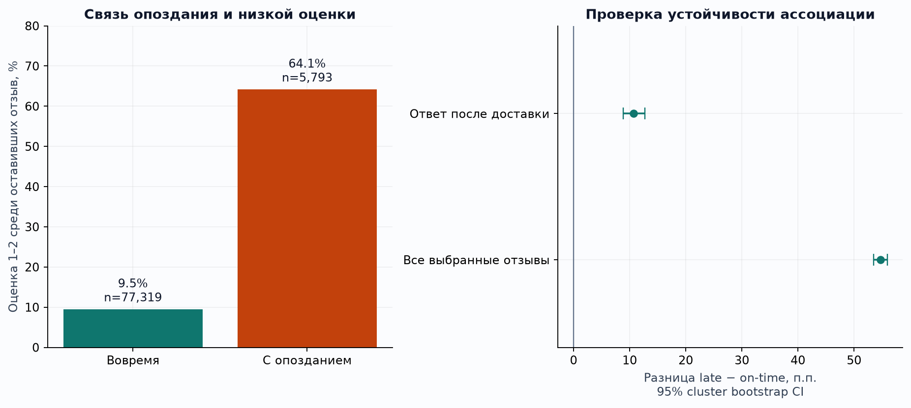

# Olist · продуктовая аналитика маркетплейса

**Вопрос:** как растёт маркетплейс и где улучшать опыт покупателя после заказа?

В первом полугодии 2018 GMV доставленных товаров вырос на **181.6%** к тому же периоду 2017. Рост сопровождается увеличением числа покупателей на **189.9%**. Повторную покупку за 90 суток совершили **2.28%** зрелых покупателей. У поздних заказов доля оценок 1–2 выше на **54.7 п.п.** (95% CI 53.5–55.9); среди отзывов, отправленных после доставки, разница уменьшается до **10.7 п.п.** Приоритет для проверки — работа с риском задержки и коммуникацией после покупки. Исторические данные показывают ассоциацию; эффект улучшения нужно измерить экспериментом.



## Посмотреть результат

- [Аналитический отчёт с выводами и действиями](reports/executive_summary.md).
- [Исполненный notebook с SQL-запросами и графиками](notebooks/02_product_analysis.ipynb).
- [Восстановленное ТЗ и критерии готовности](docs/project_brief.md).
- [Словарь метрик, окна наблюдения и ограничения](docs/metrics.md).
- [Дизайн будущего продуктового эксперимента](docs/experiment_design.md).

Это учебная реконструкция задачи, не исходное потерянное ТЗ и не заказ компании.
Анализ содержит 96 211 доставленных заказов бизнес-периода и R$ 13 181 027.13 GMV товаров.
GMV не является выручкой маркетплейса; наблюдательные различия не доказывают причинный эффект.

## Воспроизвести

Python 3.13 — проверенная среда. Команды запускаются из корня проекта:

```powershell
python -m venv .venv
.\.venv\Scripts\python.exe -m pip install -r requirements.txt
.\.venv\Scripts\python.exe scripts/build_portfolio.py
.\.venv\Scripts\python.exe -m unittest discover -s tests -v
```

В существующей среде достаточно последних двух команд. На macOS/Linux используйте `.venv/bin/python`.
Для интерактивного открытия notebook дополнительно нужен Jupyter; при сборке его код выполняется автоматически.
Сборщик сам записывает все таблицы, графики, численные выводы и исполненный notebook.
Он использует исходные CSV и отдельную `data/portfolio.duckdb`; для пересборки достаточно этих CSV и кода.

Источник — [Brazilian E-Commerce Public Dataset by Olist](https://www.kaggle.com/datasets/olistbr/brazilian-ecommerce),
анонимизированные заказы 2016–2018, лицензия данных **CC BY-NC-SA 4.0**.
Скачайте и распакуйте 9 CSV в `data/` с оригинальными именами:

```text
olist_customers_dataset.csv
olist_geolocation_dataset.csv
olist_orders_dataset.csv
olist_order_items_dataset.csv
olist_order_payments_dataset.csv
olist_order_reviews_dataset.csv
olist_products_dataset.csv
olist_sellers_dataset.csv
product_category_name_translation.csv
```

Данные уже присутствуют в текущей рабочей папке. Добавлен корневой `.gitignore` для новых данных и окружения.
CSV и исходная БД, уже отслеживаемые Git, остаются в истории: `.gitignore` не удаляет их из индекса.
При публикации сохраняйте атрибуцию и условия лицензии данных.

## Как устроен анализ

```text
CSV → scripts/build_portfolio.py → data/portfolio.duckdb
    → sql/06_portfolio_marts.sql    # заказы, позиции, покупатели
    → sql/07_product_metrics.sql    # рост, повтор, когорты, доставка, отзывы
    → проверки → reports/tables/ + reports/figures/
    → reports/executive_summary.md + notebooks/02_product_analysis.ipynb
```

Основной бизнес-период: январь 2017 — август 2018. Cutoff активности покупок: 01.09.2018, не включительно.
Для сервиса используется январь 2017 — июнь 2018 с буфером на исполнение.
Повторные покупки считаются по `customer_unique_id`, только в зрелых окнах.
Отзыв детерминированно выбирается один на заказ. Items и payments агрегируются до JOIN.
Кластерный бутстрап по покупателям: 2000 повторений, seed=42;
Wilson CI для долей повторов. Параметры и хеши входов — [manifest.json](reports/manifest.json).

Сборка прерывается при нарушении инвариантов данных; в текущей версии прошло 20 проверок.
Тесты проверяют финансовые сверки и синтетические случаи: размножение строк, последний отзыв,
доставку в обещанный день, NULL дат, границы 90 суток, зрелость когорт и временную последовательность.

## Исходные исследования

`notebooks/01_visualization.ipynb`, SQL01–05 и учебные `*_practice.py` сохранены как черновики.
В старом SQL03 есть посторонний учебный запрос к `users`, в исходном notebook — незавершённая ячейка статистики.
Для готового проекта используйте новый пайплайн выше. Пользовательские черновики не переписаны.

## Чего данные не позволяют заключить

Нет визитов, показов, расходов на привлечение, комиссий, маржи и назначения A/B-варианта.
Не оцениваются conversion из трафика, CAC, LTV бизнеса, прибыль, NPS или фактический эффект эксперимента.
Первый наблюдаемый покупатель может иметь неизвестную прошлую историю; статусы и отзывы взяты из итогового снимка.
Полнота конца периода не гарантирована. Предложения из отчёта — гипотезы для последующей проверки.
