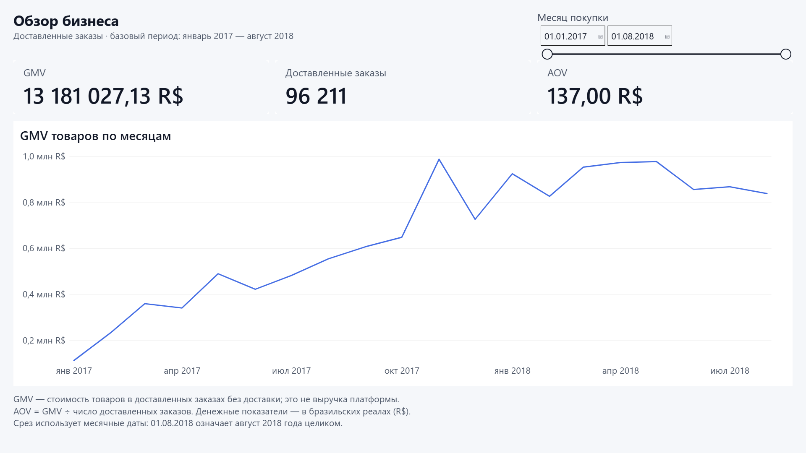
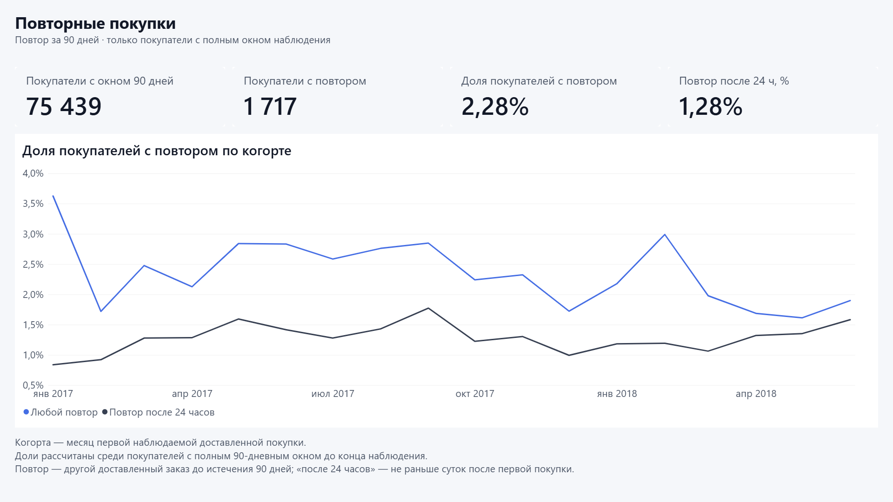
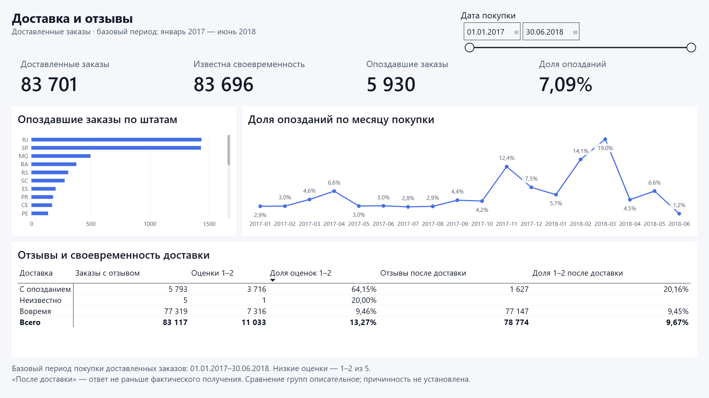

# Интерактивный отчёт Olist в Power BI

[Готовый отчёт — Olist.pbix](Olist.pbix) · [Редактируемый проект — Olist.pbip](project/Olist.pbip)

Три страницы отвечают на вопросы о росте, повторных покупках и качестве доставки.
Показатели сверены с SQL-витринами. Денежные значения указаны в бразильских реалах (R$).

| Страница | Содержание | Базовый период |
| --- | --- | --- |
| Обзор бизнеса | GMV товаров, доставленные заказы, средний чек, месячная динамика | Январь 2017 — август 2018 |
| Повторные покупки | Покупатели с полным окном наблюдения, доли повторных покупателей по когортам | Первые покупки с января 2017; только полные окна 90 дней |
| Доставка и отзывы | Опоздания по штатам и месяцам, сравнение оценок | Покупки с января 2017 по июнь 2018 |

## Просмотр

Скачайте `Olist.pbix` и откройте его в Power BI Desktop. Сохранённые данные уже находятся
внутри файла; CSV нужны при обновлении. Срез в шапке ограничивает период покупки
на текущей странице. На обзоре первое число месяца обозначает месяц целиком.
Выбор штата или статуса доставки фильтрует остальные визуализации страницы сервиса.
Чтобы сбросить выделение, нажмите на выбранный элемент ещё раз.





## Обновление данных

1. Разместите исходные CSV в `data/`, как описано в [основном README](../README.md).
2. Из корня проекта выполните:

   ```powershell
   .\.venv\Scripts\python.exe scripts/build_portfolio.py
   .\.venv\Scripts\python.exe scripts/export_powerbi_service.py
   ```

3. Откройте `Olist.pbix` либо `project/Olist.pbip` в Power BI Desktop.
4. В Power Query выберите **Управление параметрами** и задайте `ProjectRoot`:
   полный путь к своей папке `olist-marketplace-analysis`, без завершающего `\`.
5. Примените изменения и обновите данные. Сверьте карточки по таблице ниже.

Четыре источника CSV: `reports/tables/a_monthly.csv`, `reports/tables/a_repeat90.csv`,
`data/powerbi/service_orders.csv` и `data/powerbi/service_calendar.csv`.
Выгрузка сервиса создаётся локально и не хранится в Git. Экспортёр сверяет пять
показателей каждого месяца с SQL и сохраняет контрольные суммы.

## Модель и расчёты

`a_monthly` содержит строку на месяц, `a_repeat90` — строку на когорту первой наблюдаемой
доставленной покупки. Эти агрегированные таблицы независимы.
Для сервиса используется факт `service_orders` с одной строкой на доставленный заказ
и календарь `service_calendar` с одной строкой на день. Активная связь:
`service_calendar[date]` **1 → \*** `service_orders[purchase_date]`, фильтрация в одну сторону.
Автоматические таблицы дат Power BI служебные; на графиках выбраны явные поля месяца.

Меры DAX хранятся в `project/Olist.SemanticModel/definition/tables/`.
AOV — суммарный GMV, делённый на число доставленных заказов.
Доли повторов — сумма покупателей с повтором, делённая на сумму покупателей с полным окном.
Доля опозданий использует только заказы с известной своевременностью.
Готовые месячные проценты не усредняются.

| Карточка без дополнительных фильтров | Значение |
| --- | ---: |
| GMV товаров | 13 181 027,13 R$ |
| Доставленные заказы, бизнес-период | 96 211 |
| AOV | 137,00 R$ |
| Покупатели с полным окном 90 дней | 75 439 |
| Повторные покупатели | 1 717 |
| Доля повторных покупателей | 2,28% |
| Повтор спустя 24 часа или позже | 1,28% |
| Доставленные заказы, сервисный период | 83 701 |
| Известна своевременность | 83 696 |
| Опоздавшие заказы | 5 930 |
| Доля опозданий | 7,09% |

GMV не является выручкой платформы. Сравнение отзывов показывает связь со своевременностью,
но не причинный эффект задержки. Отбор отзывов после получения товара меняет состав групп.
Определения и ограничения — в [словаре метрик](../docs/metrics.md).

## Исходники и проверка

`project/` содержит открытые определения PBIR и TMDL, `olist_theme.json` — тему,
`previews/` — снимки готовых страниц. Кеши Desktop и резервные копии исключены через `.gitignore`.
Перед внешним редактированием определений сохраните отчёт; затем заново откройте проект,
чтобы Desktop прочитал изменения с диска.

```powershell
.\.venv\Scripts\python.exe scripts/validate_powerbi.py
```

Проверка контролирует структуру страниц, геометрию, источники и связи модели.
Она дополняет визуальный просмотр в Desktop и сверку чисел с SQL.
Правила шрифтов, отступов и контраста — в [спецификации оформления](design_spec.md).
