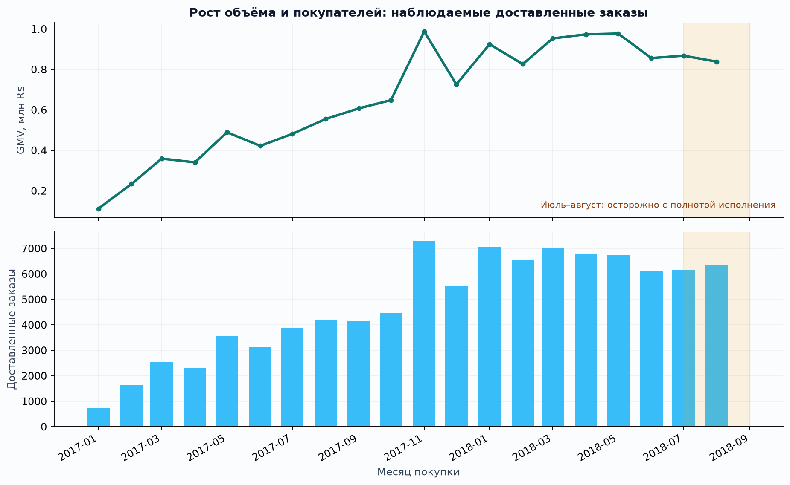
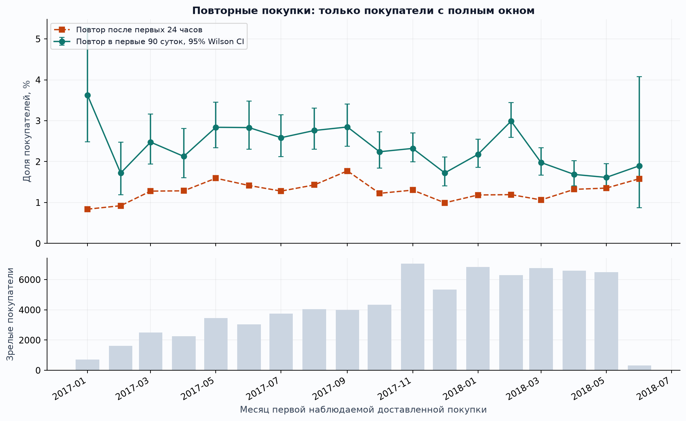
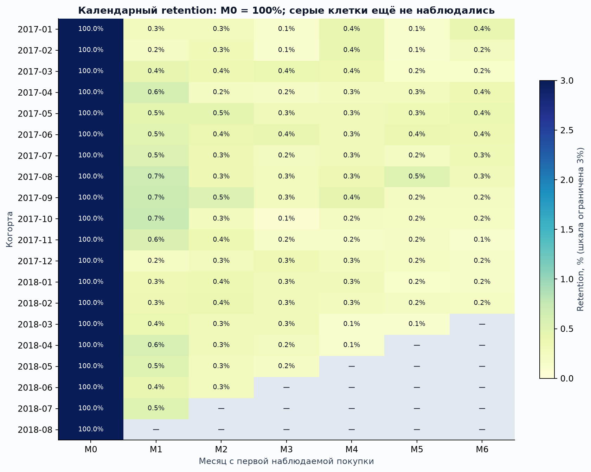
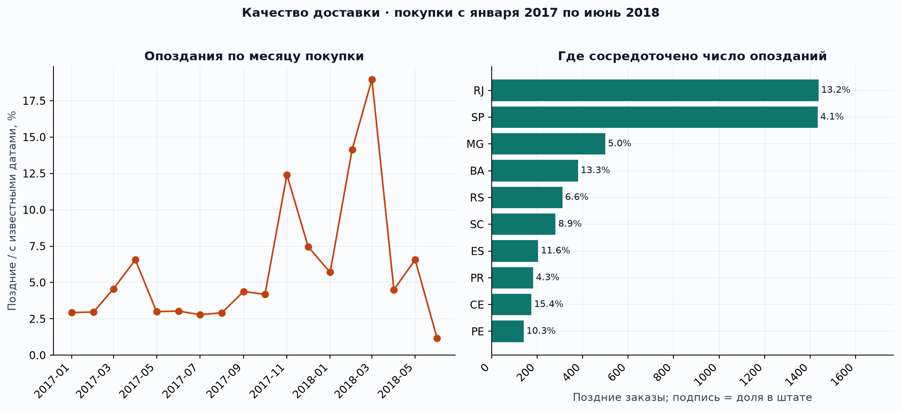
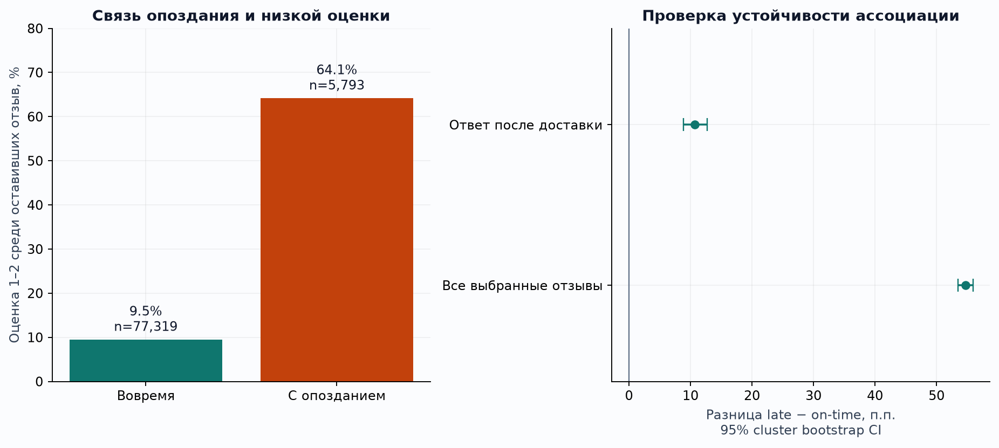
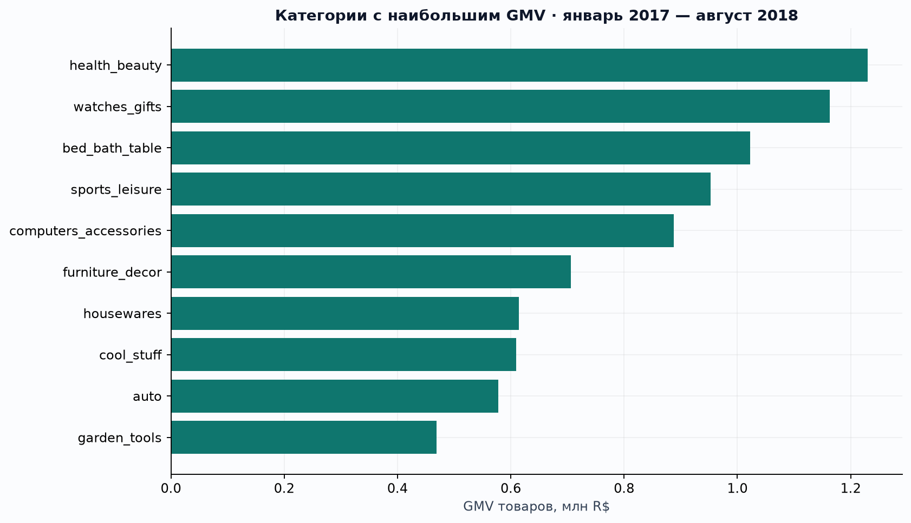

# Olist: рост маркетплейса и качество покупательского опыта

В первом полугодии 2018 GMV доставленных товаров вырос на **181.6%** к тому же периоду 2017. Рост сопровождается увеличением числа покупателей на **189.9%**. Повторную покупку за 90 суток совершили **2.28%** зрелых покупателей. У поздних заказов доля оценок 1–2 выше на **54.7 п.п.** (95% CI 53.5–55.9); среди отзывов, отправленных после доставки, разница уменьшается до **10.7 п.п.** Приоритет для проверки — работа с риском задержки и коммуникацией после покупки. Исторические данные показывают ассоциацию; эффект улучшения нужно измерить экспериментом.

## Контекст решения

Это портфолио продуктового аналитика: определить направления улучшения post-purchase опыта на данных заказов.
Заказчик и продуктовая задача реконструированы для учебного проекта; исходное ТЗ неизвестно.
Выгрузка содержит 99 441 заказов. Основной бизнес-период — 01.01.2017–31.08.2018:
99 092 заказов всех статусов, 96 211 доставленных, GMV **R$ 13 181 027.13**.
GMV — стоимость товаров без доставки, не выручка платформы. Данные статусов — итоговый снимок.

## 1. Рост: больше покупателей, а не доказанное улучшение удержания

Сравниваем одинаковые полугодия, чтобы не принять разную длину периодов за рост:

| Период | Заказы | Покупатели | GMV R$ | Заказов/покупатель | AOV R$ |
| --- | --- | --- | --- | --- | --- |
| 2017 H1 | 13933 | 13594 | 1,957,151.91 | 1.02 | 140.47 |
| 2018 H1 | 40273 | 39413 | 5,511,595.02 | 1.02 | 136.86 |

GMV = уникальные покупатели × заказы на покупателя × AOV.
Мультипликативная декомпозиция: покупатели +189.9%, частота -0.3%,
AOV -2.6%; всего заказов +189.0%, GMV +181.6%.
Это сравнение агрегатов, а не доказательство причин роста или эффективности привлечения.

Июль–август показаны для контекста, но близость к концу выгрузки ограничивает выводы об исполнении.
Статусы заказа не образуют событийную воронку. Конверсия из посещения в покупку здесь не наблюдается.

## 2. Повторные покупки: зрелые окна и проверка чувствительности

Первый заказ — первый **наблюдаемый доставленный** заказ покупателя во всей доступной истории.
Заказанные до 2017 товары участвуют в определении первой покупки, но их когорты исключены из итоговой метрики.
Повтор за первые 90 суток: **1 717 / 75 439 = 2.28%**,
95% Wilson CI **2.17–2.38%**.
Среди вторых заказов 782 сделаны в первые 24 часа;
они могут отражать разбиение покупки и не обязательно означают возвращение после использования товара.
Если считать любое повторное событие только после первых 24 часов, результат —
**963 / 75 439 = 1.28%**.
Это изменение определения события, покупатели остаются в знаменателе.

При более раннем конце наблюдения 01.08.2018: **2.35%**
на 69 142 зрелых покупателях. Состав когорт меняется; это чувствительность к cutoff,
а не сравнение одинаковых групп. В июне 2018 зрелой может быть только ранняя часть месячной когорты;
число вошедших покупателей показано под графиком.

Календарный retention отвечает другому вопросу: был ли хотя бы один доставленный заказ в месяце M1–M6.
M0 = 100% по построению; неполные календарные месяцы оставлены пустыми, а не заменены нулями.

## 3. Доставка: приоритет по объёму проблемы

Для сервиса берём покупки до 01.07.2018: остаётся минимум 62 дня до конца окна.
Это консервативный буфер, а не гарантия полноты доставки. Анализ условен на статус delivered.
Поздних заказов **5 930 / 83 696 = 7.09%**.
В сервисном срезе 5 заказов с неизвестной своевременностью;
они не входят в знаменатель. Самый высокий показатель по месяцу покупки:
**2018-03 — 18.96%**.

| Штат | Заказы с датами | Поздние | Поздние, % |
| --- | --- | --- | --- |
| RJ | 10891 | 1436 | 13.19 |
| SP | 34523 | 1432 | 4.15 |
| MG | 9975 | 499 | 5.00 |

Три штата с наибольшим числом опозданий дают **56.8%** поздних заказов.
Порог для сравнения штатов — минимум 100 заказов с известными датами.
Это список для диагностики логистики; различия состава заказов не позволяют приписать проблему штату или продавцу.

## 4. Отзывы и возврат: сильная ассоциация, осторожная интерпретация

Доля оценок 1–2 среди оставивших отзыв: **64.15%** при опоздании
(n=5 793) и **9.46%** при своевременной доставке
(n=77 319). Разница **54.68 п.п.**,
95% percentile CI **[53.45; 55.91]**, кластерный бутстрап по покупателям:
2000 повторений, seed=42, 80 462 кластеров.
Один выбранный отзыв на заказ; 584 заказов без оценки в сервисном срезе.

4 338 ответов на отзывы отправлены до доставки,
из них 4 166 относятся к поздним заказам.
На ответах только после доставки разница составляет **10.71 п.п.**,
CI **[8.84; 12.71]**.
Доли низких оценок в этом срезе — **20.16%** у late
и **9.45%** у on-time.
Фильтр оставляет **28.1%** late-отзывов
и **99.8%** on-time-отзывов.
Время ответа существенно меняет состав сравниваемых групп. Это отдельный срез,
а не исправленный причинный эффект; большой исходный разрыв нельзя переносить на опыт после получения товара.
После стандартизации по месяцу покупки × штату разница **50.37 п.п.**:
веса пропорциональны числу reviewed-заказов в стратах, где есть обе группы;
покрытие **96.7%**, страт **339**.
Для стандартизированной оценки интервал не рассчитан. Скрытые факторы и селекция отзывов остаются.

Повтор после доставки считается отдельно: любая последующая доставленная покупка строго после
первой доставки и до delivery + 90 суток, с полным окном наблюдения.
В когортах сервисного периода это **833 / 73 075 = 1.14%**.

| Опоздание первого заказа | Покупатели | Повторили | Повтор, % | CI нижняя, % | CI верхняя, % |
| --- | --- | --- | --- | --- | --- |
| False | 67811 | 791 | 1.17 | 1.09 | 1.25 |
| True | 5264 | 42 | 0.80 | 0.59 | 1.08 |

Эти группы сформированы по фактическому исходу доставки. Разницы не являются причинным эффектом.
Нельзя объяснять доставкой повтор, который произошёл раньше неё. Поля статусов и отзывов относятся
к итоговому снимку, а cutoff ограничивает активность покупок и зрелость окон, не восстанавливает историческое состояние системы.

## 5. Ассортимент как контекст, а не готовое решение

Топ-10 категорий дают **62.5%** GMV.
В категорийном анализе деньги распределены по позициям; число заказов между категориями неаддитивно.
Рост категории сам по себе не доказывает, что в неё нужно инвестировать: нет маржи, затрат и экспозиции каталога.

## 6. Решения и следующий эксперимент

| Приоритет | Действие | На что опирается | Как проверить |
| --- | --- | --- | --- |
| 1 | Разобрать логистику в штатах с наибольшим числом поздних заказов и пиковые месяцы | Число и доля опозданий | Детализация carrier/seller/route, обещанные сроки и операционные причины |
| 2 | Проверить проактивное уведомление при риске задержки | Устойчивая связь late и низкой оценки | Рандомизированный тест на уровне покупателя до уведомления |
| 3 | Исследовать разбиение покупок и паттерны повторного спроса | Чувствительность repeat90 к первым суткам | Идентификатор сессии, связь заказов, интервью и события использования |

Для будущего A/B основная метрика — ITT-повтор на покупателя в фиксированном 150-дневном горизонте:
index-заказ доставлен в первые 60 суток, затем повтор в следующие 90 суток.
Все рандомизированные eligible buyers остаются в знаменателе, включая недоставленные index-заказы.
Подробности, guardrails и критерии анализа — в [дизайне эксперимента](../docs/experiment_design.md).

Планировочный proxy baseline из conditional post-delivery метрики — **1.14%**.
При MDE **+0.5 п.п.**, α=0.05, мощности 80%, 1:1 normal approximation даёт
**8 605 покупателей на группу**, всего **17 210**.
При таком baseline +0.5 п.п. соответствует **43.9%**
относительного увеличения: тест рассчитан на обнаружение крупного относительного изменения.
Это иллюстрация расчёта чувствительности, не прогноз эффекта. До запуска нужно оценить реальный
baseline на high-risk ITT shadow cohort, долю достижимых eligible buyers и стоимость ожидания 150 дней.
Оценки риска должны использовать только данные, доступные на момент назначения варианта.

## Надёжность и воспроизведение

Сборка прошла **20 проверок**; результаты — [data_quality.json](data_quality.json).
Зерно и денежные итоги сверяются с CSV; тесты дополнительно проверяют fanout, даты и границы окон.
За пределами cutoff исключено 20 редких поздних заказов.
В бизнес-периоде 0 delivered-заказов без платежных строк; GMV считается по позициям.
Платежи не принудительно приравниваются к стоимости товаров + доставке: это отдельная сущность.
Из 96 211 заказов с платежами у 294
разница превышает 0.01 BRL по модулю; суммарная знаковая разница
payment − items − freight = **R$ 2 755.43**.
Это диагностическая сверка, она не интерпретируется как прибыль или возвраты.
Хеши входов, SQL, конфигурация и версии — [manifest.json](manifest.json);
численные статистические результаты — [statistics.json](statistics.json).

Источник: [Olist, Brazilian E-Commerce Public Dataset](https://www.kaggle.com/datasets/olistbr/brazilian-ecommerce),
лицензия данных CC BY-NC-SA 4.0. Заказы анонимизированы; период источника 2016–2018.
Нет данных о визитах, CAC, марже, комиссиях, возвратах денег и рандомизации.
Поэтому здесь не оцениваются конверсия из трафика, прибыль, LTV бизнеса, NPS или фактический A/B-эффект.
История до начала выгрузки неизвестна, а полнота активности в конце августа не гарантирована.
